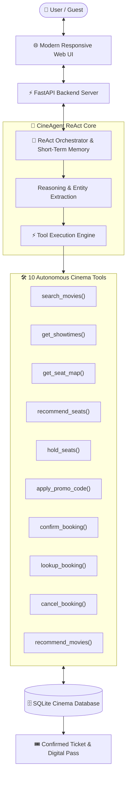
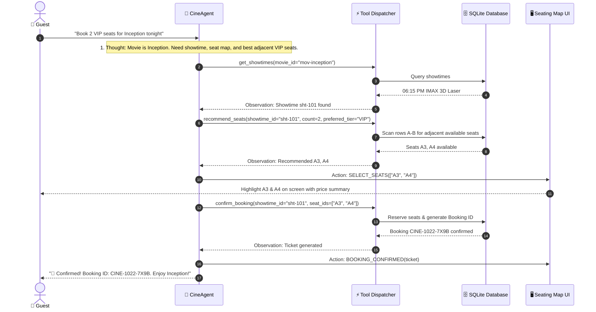

# 🎬 CineAgent AI — Autonomous Movie Ticket Booking System

[](https://www.python.org/)
[](https://fastapi.tiangolo.com/)
[](LICENSE)
[]()

> An autonomous, AI-driven cinema concierge that leverages the **ReAct (Reasoning + Acting)** framework to discover movies, inspect real-time theater schedules, recommend optimal seating tiers, apply promotional discounts, and issue digital boarding passes with instant QR codes.

---

## 🌟 Highlights & Features

- 🤖 **Autonomous ReAct AI Agent**: Real-time multi-turn reasoning with tool execution traces showing exact latency, parameters, and observations.
- 🪑 **Interactive Seating Hall**: Color-coded tiers (VIP Recliners, Premium Center, Standard) with live seat locking, selection summaries, and curved screen visualization.
- ⚡ **10 Specialized Cinema Tools**: Autonomously invoked by the agent to query movies, compare showtimes, recommend adjacent seats, calculate taxes/discounts, and confirm bookings.
- 🎟️ **Digital Boarding Pass & QR Code**: Generates printable and downloadable cinema tickets complete with reservation barcodes, seat numbers, and theater credentials.
- 🏷️ **Dynamic Discount Engine**: Auto-validates promo codes like `WELCOME20` (20% off) and `POPCORN5` ($5 off).
- 🔄 **Two-Way UI Synchronization**: Clicking in the visual UI updates the agent's context, and agent commands automatically manipulate the UI seat map and booking drawer.
- 🚀 **Dual-Engine Flexibility**:
  - **Autonomous Built-in Engine**: Works 100% locally and offline out-of-the-box without requiring API keys or third-party paid credits.
  - **External LLM Ready**: Optional plug-and-play support for Gemini API (`GEMINI_API_KEY`) and OpenAI (`OPENAI_API_KEY`).

---

## 🏗️ System Architecture



---

## 🔄 The Agentic ReAct Cycle



---

## 🛠️ Registered Agent Tools

| Tool | Parameters | Description |
| :--- | :--- | :--- |
| `search_movies` | `query`, `genre`, `min_rating` | Search the movie catalog by title, director, or genre. |
| `get_showtimes` | `movie_id`, `date` | Retrieve theaters, formats (IMAX 3D, Dolby Atmos), and times. |
| `get_seat_map` | `showtime_id` | Live status (available, held, booked) and tier prices. |
| `recommend_seats` | `showtime_id`, `count`, `preferred_tier` | Finds best adjacent seats based on tier and viewing angle. |
| `hold_seats` | `showtime_id`, `seat_ids`, `customer_name` | Temporarily locks seats for 5 minutes during checkout. |
| `apply_promo_code` | `showtime_id`, `seat_ids`, `promo_code` | Validates coupons (`WELCOME20`, `CINE10`, `POPCORN5`). |
| `confirm_booking` | `showtime_id`, `seat_ids`, `customer_name`, ... | Permanently books seats and generates boarding pass QR data. |
| `lookup_booking` | `booking_id` | Retrieves status and details of an existing ticket. |
| `cancel_booking` | `booking_id` | Releases seats back to pool and issues full refund. |
| `recommend_movies` | `mood`, `preferences` | Semantic recommendations matching user vibe or occasion. |

---

## 🚀 Quickstart Guide

### 1. Prerequisites
- Python 3.10 or higher
- Git

### 2. Clone and Setup
```bash
git clone https://github.com/Chiranth-11/movie-ticket-booking-ai.git
cd movie-ticket-booking-ai

# Optional: Create and activate virtual environment
python -m venv venv
# On Windows:
.\venv\Scripts\activate
# On Linux/macOS:
source venv/bin/activate

# Install dependencies
pip install -r requirements.txt
```

### 3. Run the Application
```bash
python run.py
```
*Your browser will automatically open to `http://localhost:8000`.*

---

## 🧪 Running Automated Tests

Run the built-in test suite (13 unit & integration tests) with zero external test runners:

```bash
python -m unittest discover tests
```

Sample output:
```text
.............
----------------------------------------------------------------------
Ran 13 tests in 0.028s

OK
```

---

## 📂 Project Directory Structure

```text
movie-ticket-booking-ai/
├── backend/
│   ├── app.py                  # FastAPI application with routes & static mounting
│   ├── config.py               # Settings, pricing tiers, and promo codes
│   ├── database.py             # SQLite schema and realistic catalog seeding
│   ├── models.py               # Pydantic schemas (Movie, Seat, Booking, Chat)
│   ├── agent/
│   │   ├── __init__.py
│   │   ├── core.py             # CineAgent stateful orchestrator & memory
│   │   ├── llm_provider.py     # Autonomous ReAct Engine + optional Gemini/OpenAI
│   │   ├── prompts.py          # System prompt & conversational instructions
│   │   └── tools.py            # Concrete tool declarations & execution dispatcher
│   └── services/
│       ├── __init__.py
│       ├── booking_service.py  # Seat holds, pricing logic, checkout & cancellations
│       └── movie_service.py    # Movie catalog, showtimes, and recommendation filters
├── frontend/
│   ├── index.html              # Modern cinema web UI with seat map & chat pane
│   ├── css/
│   │   └── styles.css          # Cyberpunk cinema styling, glassmorphism, responsive
│   └── js/
│       ├── app.js              # State manager, seat selection, boarding pass modal
│       └── chat.js             # ReAct tool-call badge viewer & live UI synchronization
├── tests/
│   ├── test_agent.py           # Unit tests for tools and ReAct reasoning
│   └── test_api.py             # Direct integration tests for FastAPI endpoints
├── .gitignore
├── README.md                   # Complete architectural documentation
├── requirements.txt
└── run.py                      # One-click launcher
```

---

## 🎟️ Active Promotional Codes

Test these codes in the chat (e.g., *"Apply promo code WELCOME20"*):
- `WELCOME20`: 20% discount on entire booking
- `CINE10`: 10% discount on entire booking
- `POPCORN5`: $5.00 flat discount

---

## 👨‍💻 Author & Contributions

- **Author**: Chiranth C Gutthi ([@Chiranth-11](https://github.com/Chiranth-11))
- **Email**: chiranthgutthi@gmail.com
- **License**: MIT
